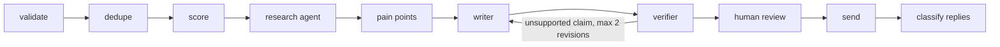

# Outreach Agent

Give it a company website and a person's name and role. It researches the company, works
out a problem that person probably has, and writes a short cold email in which **every
fact about the company is backed by a real source URL and an exact quote from that page**.

A human approves every email. Nothing is ever sent automatically.

## The problem it solves

A sales rep (SDR) who wants a cold email to land has to research each company by hand:
what they do, what changed recently, who to write to, and what to say that isn't generic.
That takes 10 to 20 minutes per lead, so most teams skip it and send templates.

Asking an LLM to "write a personalised email" is fast, but it invents facts. One made-up
funding round or wrong product name in a cold email costs the sender their credibility.

This project does the research automatically and refuses to use anything it cannot prove.

## What comes out

One real run, on posthog.com for a "Head of Growth". The sender here is a made-up test
company, so this email was never sent:

> **Subject: Free-to-paid at PostHog**
>
> Hi Alex,
>
> 98% of PostHog customers use it for free, with usage-based paid products on top. Teams
> with a base like that often find the real leak is in onboarding, where free users stall
> before they reach a paid tier or a second product.
>
> At Onboardly we help B2B software companies find and fix the onboarding steps where new
> users drop off. We lifted trial-to-paid conversion 18% in 10 weeks for a 40-person
> analytics startup.
>
> Open to a 15-minute call next week?
>
> Sam

The reviewer sees the evidence next to the draft:

| Claim in the email | Source | Quote found on that page |
|---|---|---|
| 98% of PostHog customers use it for free | https://posthog.com/ | "All our paid products are pay-per-use with generous monthly free tiers. In fact, 98% of our customers use PostHog for free." |

That run took 37 seconds and cost an estimated $0.086.

## How it works



| Step | What it does |
|---|---|
| validate, dedupe | Cleans the input and skips a person contacted in the last 30 days. |
| score | A cheap check of whether this role fits the offer. A poor fit stops here for about $0.001, before any research is paid for. |
| research agent | Searches the web and reads pages. Returns facts, each with a source URL and exact quotes. |
| pain points | Reasons from those facts to a likely problem, stated as a hypothesis. |
| writer | Writes under 120 words: one sourced opener, one pain point, one proven result, one ask. |
| verifier | Checks every claim in the email against the research. Unsupported claims go back to the writer. |
| human review | A person approves, edits or rejects. Approval is required before sending. |
| send | Sends through an email provider with an unsubscribe link and a suppression list. |
| classify replies | Sorts replies (interested, not now, unsubscribe, ...) and suggests the next step. |

## Why you can trust the output

The main design rule is that **code controls the flow and the model only does the
thinking**. Wherever a mistake would matter, plain code makes the final decision.

- **Grounding is checked by code, not by the model.** A fact is kept only if its URL was
  really fetched in this run and its quote really appears in the page text.
- **The verifier maps each claim to a source.** Code then decides whether the email passes.
- **A failed run resumes from the failed step.** Every step saves its output, so nothing
  is paid for twice.
- **Web pages and replies are treated as untrusted text.** The research agent has only
  three tools (search, fetch a page, finish). It cannot send email or touch the database,
  so a malicious page has nothing to hijack.
- **An opt-out always wins.** If a reply says "remove me", code puts the address on the
  suppression list, whatever the model thinks and even if the model is down.
- **Spending is capped.** Rate limits per team and per visitor, plus a daily spending cap.
- **Every model call is traced** with its tokens and estimated cost.

## Current status

The backend is deployed (API, worker and Redis on Railway, Postgres on Supabase) and has
run a real lead end to end.

| Part | Status |
|---|---|
| Research, pain points, writer, verifier | Working, run on real companies |
| API, job queue, worker, database, resume | Working, deployed |
| API keys, per-team data, rate limits, spending cap | Working |
| Review API (approve, edit, reject) | Working. No screen for it yet |
| Sending | Built and tested with a fake provider. No real email has been sent |
| Reply classification | Built and tested with fakes. Accuracy not measured yet |
| Frontend | Not started |

Measured so far, on small samples (treat as indications, not benchmarks):

- Cost per lead: $0.08 to $0.14 across 10 leads, estimated from token counts.
- Time per lead: 34 to 78 seconds.
- Research is 60 to 70% of the cost.
- Emails that passed the verifier: 10 of 10 in that set.

Not yet established: how good the emails are in the eyes of real sales people, and reply
rates. The automated email judge is still being calibrated. The full dated history,
including what went wrong, is in [docs/ROADMAP.md](docs/ROADMAP.md).

## Tech stack

Python 3.12, FastAPI, Redis with Arq for background jobs, Postgres with SQLAlchemy 2.0
(async) and Alembic, Pydantic v2, and the Anthropic Python SDK.

The agent loop is written by hand on the SDK, with no agent framework. That keeps cost,
retries and limits fully under the project's control. Claude Sonnet does research and
writing; Claude Haiku does scoring, verification and classification. Search is Exa, behind
an interface. Tracing is Logfire. Docker for deployment.

## Run it locally

You need [uv](https://docs.astral.sh/uv/), Docker, an Anthropic API key and an Exa API key.

```bash
git clone https://github.com/moizkaseer/cold-outreach-agent.git
cd cold-outreach-agent
uv sync
cp .env.example .env          # then add ANTHROPIC_API_KEY and EXA_API_KEY
```

Run the tests. They use fakes and cost nothing:

```bash
uv run pytest
```

Start the whole stack (Postgres, Redis, migrations, API, worker):

```bash
docker compose up --build     # API on http://localhost:8000
```

Create an API key, then start a run. A run calls the real models and costs about $0.09:

```bash
docker compose run --rm api python -m scripts.create_api_key "My team"

curl -X POST http://localhost:8000/runs \
  -H "Authorization: Bearer YOUR_KEY" -H "Content-Type: application/json" \
  -d '{
    "domain": "posthog.com",
    "person_name": "Alex Morgan",
    "person_role": "Head of Growth",
    "sender": {
      "name": "Your name",
      "company": "Your company",
      "offer": "What you sell, in one sentence.",
      "outcomes": ["A real result you can prove."],
      "ask": "Open to a 15-minute call next week?"
    }
  }'
```

The answer contains a `run_id`. Follow it with `GET /runs/{run_id}` or the live stream at
`GET /runs/{run_id}/events`. Interactive API docs are at http://localhost:8000/docs.

## API overview

| Endpoint | Purpose |
|---|---|
| `POST /runs` | Start a run for one lead |
| `GET /runs/{id}`, `GET /runs/{id}/events` | Status, steps and cost; live progress |
| `POST /runs/{id}/resume` | Retry a failed run from the failed step |
| `GET /emails`, `GET /emails/{id}` | Review queue; a draft with its evidence |
| `PATCH /emails/{id}`, `POST .../approve`, `POST .../reject` | Review decisions |
| `POST /emails/{id}/send` | Send an approved email |
| `POST /emails/{id}/replies`, `GET /replies` | Classify and list replies |
| `GET /unsubscribe/{token}`, `GET /suppressions` | Opt-out handling |

## Project layout

```
app/
  agents/      research, pain points, writer, verifier, scorer, replies, and the agent loop
  pipeline/    the state machine that runs the steps and resumes failures
  api/         FastAPI routes: runs, review, sending, replies, auth, limits
  tools/       search and page fetching
  sending/     email provider behind an interface
  db/          models and migrations
  workers/     the background job
evals/         golden set, fact judge, email judge, prompt-injection tests
scripts/       smoke tests and helpers
tests/         unit tests (fakes only, no API calls)
docs/          roadmap and dated progress log
```

## What it will not do

- Scrape LinkedIn.
- Send an email no human has approved.
- Email an address that unsubscribed.

## About

Built by [Moiz Ali](https://github.com/moizkaseer) as a final-semester computer science
project, with the aim of building an LLM application the way a production team would:
grounded, evaluated, durable, observable and guarded.
